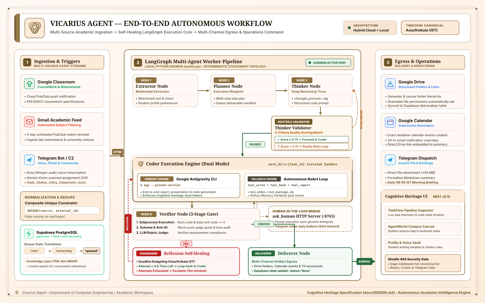
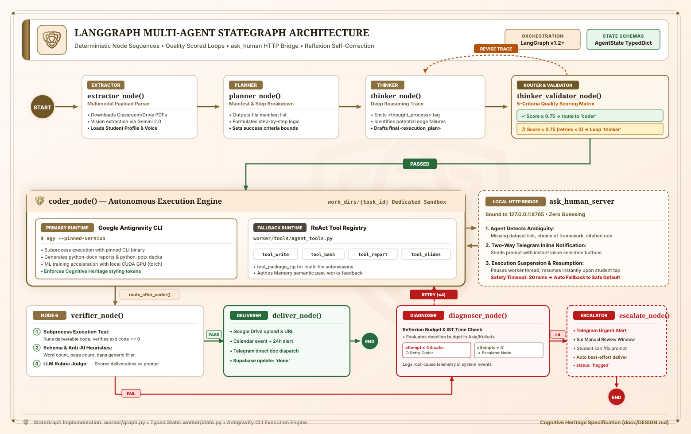
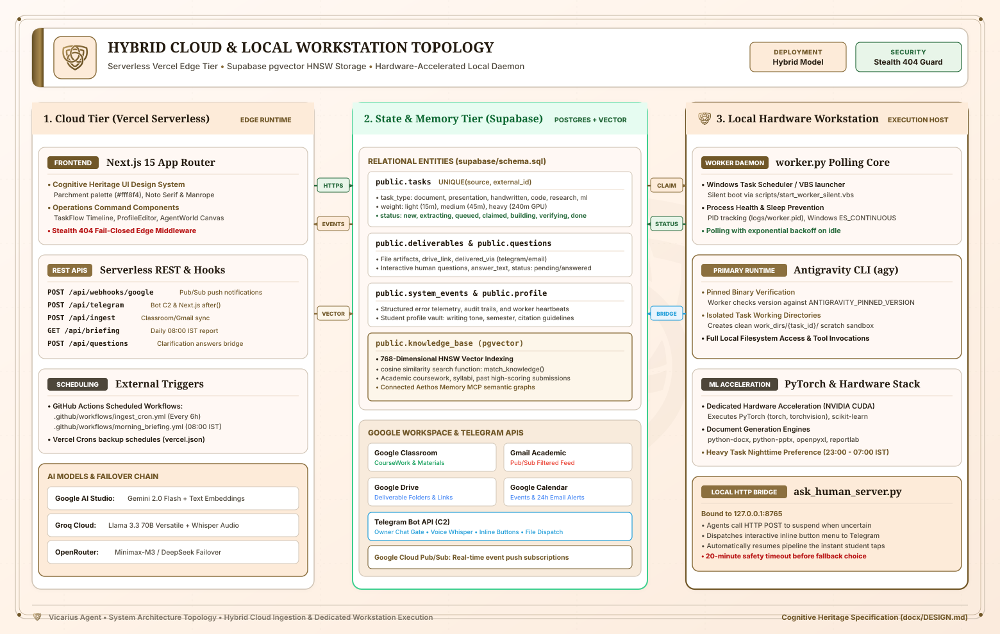
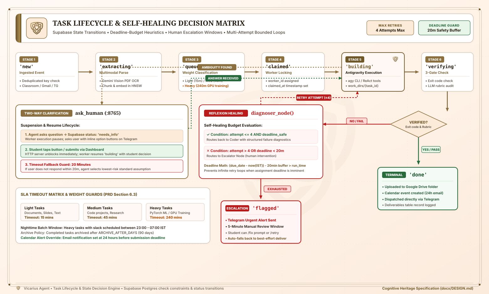
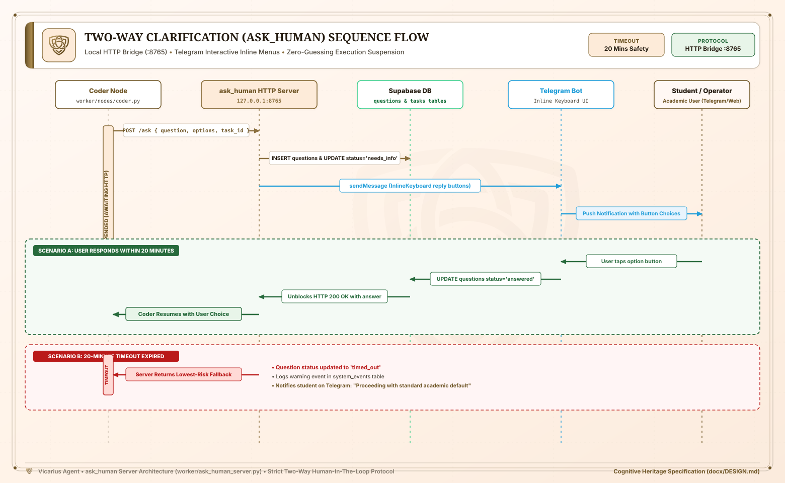

# Vicarius Agent

> Autonomous academic task ingestion, LangGraph multi-agent execution pipeline, and Cognitive Heritage operations command.

---

## Overview

Vicarius Agent is an autonomous academic operations system built for a Computer Engineering (AI-ML) student at Academic Institution. It automatically ingests assignments, coursework materials, and notices from Google Classroom and Gmail, stores and tracks them in Supabase PostgreSQL, and executes deliverables using a multi-node Python LangGraph agent pipeline paired with Google Antigravity CLI. Completed artifacts—including functional codebases, Jupyter notebooks, IEEE/APA-formatted Word documents, publication-grade PDFs, and PowerPoint decks—are verified through automated execution and rubric scoring before being uploaded to Google Drive, scheduled in Google Calendar, and dispatched via Telegram.

---

## Features

- **Automated Multi-Source Ingestion**:
  - Continuous ingestion from Google Classroom (coursework, announcements, attachments) and Gmail (filtered academic queries) via scheduled crons and Google Cloud Pub/Sub webhooks.
  - Ingestion deduplication using composite unique constraints `(source, external_id)`.
  - Automated Pub/Sub watch renewal for Gmail and Classroom push notifications.
- **Multimodal Requirement Extraction**:
  - Parses PDFs, Word documents (`.docx`), and scanned assignment images using Gemini 2.0 Flash vision and text extraction.
  - Automatic semantic chunking and 768-dimensional vector embedding storage in Supabase `knowledge_base` with HNSW cosine similarity search.
- **Self-Reflective LangGraph Worker Pipeline**:
  - **Extractor Node**: Consolidates assignment files, attachments, and student profile preferences.
  - **Planner Node**: Constructs structured execution plans and output file manifests.
  - **Thinker & Validator Nodes**: Formulates reasoning traces (`<thought_process>` and `<execution_plan>`) scored across 5 quality dimensions with a quality-retry loop (threshold >= 0.75).
  - **Coder Node**: Primary execution via Antigravity CLI (`agy`) with a secondary autonomous ReAct tool loop (`tool_write_file`, `tool_bash`, `tool_build_report`, `tool_build_presentation`, `tool_package_zip`).
  - **Verifier Node**: Executes Python scripts via subprocess checking exit codes, validates deliverable schemas, enforces anti-AI tone heuristics (banning generic filler), and runs an LLM Judge rubric.
  - **Diagnoser Node**: Bounded Reflexion self-healing (up to 4 attempts) with deadline-budget awareness calculated in `Asia/Kolkata` time.
  - **Deliverer Node**: Uploads to Google Drive, sets permissions, logs deliverable URLs, schedules Calendar reminder events with 24-hour email overrides, and sends files to Telegram.
  - **Escalator Node**: Surfaces blocking issues to Telegram with an interactive 5-minute review window before falling back to best-effort delivery.
- **Two-Way Clarification Server (`ask_human`)**:
  - Local HTTP bridge (`port 8765`) enabling autonomous agents to pause execution, query the user via Telegram inline buttons, and resume immediately upon response or timeout.
- **Interactive Operations Command Dashboard**:
  - Built with Next.js 15 App Router following the **Cognitive Heritage** design system (parchment surfaces `#fff8f4`, warm brass `#705728`, Noto Serif typography).
  - Live task status tracker, pipeline execution node visualizer (`TaskFlow`), and student profile & vault editor (`ProfileEditor`).
  - Interactive campus landmark map canvas (`AgentWorld`).
- **Fail-Closed Stealth Security**:
  - Next.js edge middleware returning stealth `404 Not Found` for any unauthorized probing. Access is granted only via bearer token, operator cookie, or authenticated Telegram user ID.
- **Telegram Command & Control Center**:
  - Two-way Telegram bot supporting status checks (`/status`), active task listing (`/tasks`), task creation (`/task`), manual retries (`/retry`), prompt fixes (`/fix`), and live Classroom/Gmail queries (`/classroom`, `/emails`, `/sync`).
  - Voice message transcription via Groq Whisper and assignment photo OCR via Gemini Vision.
- **Scheduled Telegram Briefings**:
  - Daily Morning Briefing at 08:00 IST via GitHub Actions / Vercel Cron detailing stuck tasks, imminent deadlines (<12h), and upcoming submissions.

---

## Tech Stack

### Web Application & Frontend
- **Framework**: Next.js 15.2.1 (App Router, Server Actions, React 19, TypeScript 5.8)
- **Styling**: Vanilla CSS with custom properties enforcing the Cognitive Heritage design system
- **Icons**: Lucide React & custom SVG iconography
- **Document Processing**: `pdf-parse`, `mammoth`, `jszip`

### Autonomous Worker & AI Pipeline
- **Orchestration**: Python 3.10+, LangGraph (>=1.2.0), LangChain Core (>=1.0.0)
- **Execution Engine**: Google Antigravity CLI (`agy`)
- **Document & Presentation Generation**: `python-docx`, `python-pptx`, `openpyxl`, `reportlab`
- **Machine Learning & Hardware Acceleration**: PyTorch (`torch`, `torchvision`), `scikit-learn`, `numpy`, `matplotlib`, `opencv-python`
- **System Automation**: `psutil`, `pytz`, `python-dateutil`

### Database & Storage
- **Database**: Supabase PostgreSQL with `pgvector` extension (HNSW indexing for 768-dim embeddings)
- **Cloud Storage**: Google Drive API (deliverable folders and shareable URLs)
- **State & Caching**: Supabase tables (`tasks`, `questions`, `deliverables`, `system_events`, `chat_messages`, `profile`, `knowledge_base`)

### Third-Party APIs & Integrations
- **AI Models**: Google Gemini (`gemini-2.0-flash`, `gemini-embedding-001`), Groq (`llama-3.3-70b-versatile`, Whisper), OpenRouter (`minimax/minimax-m3:free`, `meta-llama/llama-3.3-70b-instruct`)
- **Google Workspace**: Google Classroom API, Gmail API, Google Drive API, Google Calendar API, Google Cloud Pub/Sub
- **Messaging**: Telegram Bot API (long-polling / webhook with async Next.js `after()` processing)
- **External Memory**: Aethos Memory MCP / Supabase integration

### Infrastructure & Hosting
- **Dashboard & API Hosting**: Vercel (Edge & Serverless Node.js runtime)
- **Cron Scheduling**: Vercel Crons (`vercel.json`) & GitHub Actions workflows (`.github/workflows/`)
- **Worker Execution**: Local PC Background Daemon (Windows `pythonw.exe` / Windows Task Scheduler)

---

## System Architecture & Workflows

### 1. End-to-End Autonomous Workflow
The master workflow diagram maps the end-to-end journey of an academic task: ingestion from Classroom, Gmail, or Telegram, through the self-healing LangGraph worker, to verified egress in Google Drive, Calendar, and Telegram.



### 2. LangGraph Worker StateGraph Topology
A deep-dive into the deterministic StateGraph execution pipeline, showcasing the thinker validation scoring loop, dual-mode Coder (Antigravity CLI + ReAct fallback), 3-tier Verifier gate, and bounded Reflexion self-healing loop.



### 3. Hybrid Cloud & Workstation Infrastructure
The complete physical and serverless infrastructure topology: Next.js 15 App Router on Vercel Edge, Supabase PostgreSQL with `pgvector` HNSW index, Google Workspace APIs, and the dedicated hardware-accelerated local workstation daemon.



### 4. Task State Machine & Decision Matrix
The comprehensive lifecycle of tasks in Supabase: state transitions from `'new'` to `'done'`, weight-based timeout guards (15m light, 45m medium, 240m heavy GPU), and deadline-budget safety calculations in Asia/Kolkata time.



### 5. Two-Way Clarification (`ask_human`) Sequence Flow
The zero-guessing human-in-the-loop bridge: how autonomous agents safely suspend execution when detecting genuine ambiguity, dispatch interactive inline button menus to Telegram, and resume instantly upon student selection.



<details>
<summary><b>Click to expand Textual Mermaid Flowchart</b></summary>

```mermaid
flowchart TD
    subgraph INGESTION["1. Ingestion & Trigger Layer"]
        GC[Google Classroom API] -->|Pub/Sub Push / Cron| API_INGEST[/api/ingest & /api/webhooks/google]
        GM[Gmail API] -->|Pub/Sub Push / Cron| API_INGEST
        TG_USER[Telegram User Prompt / Voice / Image] -->|Webhook| API_TG[/api/telegram]
        API_INGEST -->|Normalize & Store| SUPA[(Supabase PostgreSQL)]
        API_TG -->|Parse & Store Task| SUPA
    end

    subgraph WORKER["2. Autonomous Worker Pipeline (LangGraph)"]
        SUPA -->|Claim Task| WORKER_POLL[worker.py Polling Daemon]
        WORKER_POLL --> EXTRACTOR[Extractor Node]
        EXTRACTOR --> PLANNER[Planner Node]
        PLANNER --> THINKER[Thinker Node]
        THINKER --> VALIDATOR{Thinker Validator}
        VALIDATOR -->|< 0.75 Score (Retry)| THINKER
        VALIDATOR -->|>= 0.75 Score| CODER[Coder Node]
        CODER -->|Primary: Antigravity CLI / Fallback: ReAct Tools| VERIFIER[Verifier Node]
        VERIFIER -->|Pass| DELIVERER[Deliverer Node]
        VERIFIER -->|Fail| DIAGNOSER[Diagnoser Node / Reflexion]
        DIAGNOSER -->|Attempt <= 4 & Within Deadline| CODER
        DIAGNOSER -->|Attempts Exhausted| ESCALATOR[Escalator Node]
    end

    subgraph DELIVERY["3. Egress & Operations"]
        DELIVERER -->|Upload Files| GDRIVE[Google Drive Folder]
        DELIVERER -->|Schedule Deadline Event| GCAL[Google Calendar]
        DELIVERER -->|Deliver Files & Links| TG_BOT[Telegram Notification]
        ESCALATOR -->|5-Min Review Window| TG_BOT
        SUPA <-->|Real-Time State & Profile Vault| DASH[Next.js Cognitive Heritage Dashboard]
    end
```
</details>

---

## Prerequisites

Before configuring and running the project, ensure you have:

- **Node.js**: `v20.x` or higher and `npm`
- **Python**: `v3.10` or higher (with `pip` and virtual environment support)
- **Supabase Account**: A Supabase PostgreSQL project with `pgvector` enabled
- **Google Cloud Console Project**:
  - Enabled APIs: Google Classroom API, Gmail API, Google Drive API, Google Calendar API, Google Cloud Pub/Sub
  - OAuth 2.0 Web Application credentials configured with offline access (`refresh_token`)
- **Telegram Bot**: Bot token obtained from [@BotFather](https://t.me/BotFather) and your personal Telegram numeric Chat ID
- **AI Provider API Keys**:
  - Google AI Studio API Key (Gemini)
  - Groq API Key
  - OpenRouter API Key
- **Antigravity CLI**: Pinned local CLI binary installed and authenticated (`agy`)

---

## Installation & Setup

### 1. Clone the Repository
```bash
git clone https://github.com/nisargpatel1906/Vicarius_Agent.git
cd Vicarius_Agent
```

### 2. Configure Environment Variables
Copy `.env.example` to both `.env.local` (for Next.js) and `.env` (for the Python worker):
```bash
cp .env.example .env.local
cp .env.example .env
```
Populate all required API keys and configuration values in both files.

### 3. Initialize Supabase Database
Execute the database schema and pgvector migration files in your Supabase SQL Editor:
1. Run [`supabase/schema.sql`](file:///c:/Users/Nisarg%20Patel/Documents/Vicarius_Agent/supabase/schema.sql) to create the tables (`tasks`, `questions`, `deliverables`, `system_events`, `chat_messages`, `profile`), performance indexes, and RLS policies.
2. Run [`supabase/migrations/20260904000000_create_knowledge_base.sql`](file:///c:/Users/Nisarg%20Patel/Documents/Vicarius_Agent/supabase/migrations/20260904000000_create_knowledge_base.sql) to enable the `vector` extension, build the `knowledge_base` table with HNSW indexing, and establish the `match_knowledge` vector search function.

### 4. Install Frontend Dependencies
```bash
npm install
```

### 5. Install Python Worker Dependencies
Set up a Python virtual environment and install the required packages:
```bash
python -m venv .venv

# On Windows:
.venv\Scripts\activate

# On Linux/macOS:
source .venv/bin/activate

pip install -r worker/requirements.txt
pip install -r requirements.txt
```

---

## Environment Variables

| Variable Name | Purpose |
|---|---|
| `GOOGLE_OAUTH_CLIENT_ID` | Google Cloud OAuth 2.0 Web Client ID |
| `GOOGLE_OAUTH_CLIENT_SECRET` | Google Cloud OAuth 2.0 Client Secret |
| `GOOGLE_OAUTH_REFRESH_TOKEN` | Offline access refresh token for Classroom, Gmail, Drive, Calendar, and Tasks |
| `GOOGLE_OAUTH_REDIRECT_URI` | OAuth redirect URI (e.g. `https://developers.google.com/oauthplayground`) |
| `SUPABASE_URL` | Supabase project REST / PostgreSQL endpoint URL |
| `SUPABASE_SERVICE_KEY` | Elevated service role key for backend Next.js API routes (bypasses RLS) |
| `SUPABASE_WORKER_KEY` | Scoped key for local Python worker task-queue polling and updates |
| `GROQ_API_KEY` | Groq API key for fast classification, extraction, and Whisper audio transcription |
| `GEMINI_API_KEY` | Google AI Studio API key for multimodal vision extraction and vector embeddings |
| `OPENROUTER_API_KEY` | OpenRouter API key for LLM failover chains and evaluation judge |
| `OPENROUTER_MODEL` | Default OpenRouter model identifier (e.g. `minimax/minimax-m3:free`) |
| `TELEGRAM_BOT_TOKEN` | Telegram Bot API authentication token |
| `TELEGRAM_ALLOWED_CHAT_ID` | Owner's numeric Telegram chat ID for strict single-user authorization gate |
| `ANTIGRAVITY_PINNED_VERSION` | Exact pinned Antigravity CLI version checked by worker before runs |
| `DRIVE_OUTPUT_FOLDER_ID` | Google Drive folder ID where agent output deliverables are stored |
| `INGEST_SECRET_TOKEN` | Bearer token authorizing scheduled `/api/ingest` execution |
| `DASHBOARD_ACCESS_TOKEN` | Operator access token required to unlock the web dashboard (stealth 404 gate) |
| `CRON_SECRET` | Bearer token for Vercel Cron and GitHub Actions scheduled workflow runs |
| `TIMEZONE` | Timezone for deadline math, scheduling, and morning briefings (`Asia/Kolkata`) |
| `LIGHT_TIMEOUT_MINUTES` | Timeout in minutes for light tasks like documents and presentations (default: `15`) |
| `MEDIUM_TIMEOUT_MINUTES` | Timeout in minutes for medium tasks like research and code projects (default: `45`) |
| `HEAVY_TIMEOUT_MINUTES` | Timeout in minutes for heavy tasks like ML training (default: `240`) |
| `HEAVY_JOB_PROGRESS_INTERVAL_MINUTES` | Interval in minutes for reporting progress updates for heavy jobs via Telegram |
| `HEAVY_JOB_PREFERRED_START` | Preferred start time for heavy jobs with slack in IST (e.g. `23:00`) |
| `HEAVY_JOB_PREFERRED_END` | Preferred end time for heavy jobs with slack in IST (e.g. `07:00`) |
| `JOB_TIMEOUT_MINUTES` | Default fallback subprocess execution timeout in minutes (default: `45`) |
| `QUESTION_WAIT_TIMEOUT_MINUTES` | Timeout waiting for user response via `ask_human` before auto-fallback (default: `20`) |
| `REMINDER_HOURS_BEFORE` | Threshold in hours for Google Calendar email reminder override (default: `24`) |
| `MAX_FIX_ATTEMPTS` | Total build attempts in LangGraph self-healing loop (default: `4`) |
| `DEADLINE_SAFETY_BUFFER_MINUTES` | Safety buffer in minutes subtracted during deadline budget evaluation (default: `20`) |
| `TELEGRAM_MAX_DOC_MB` | Maximum document attachment size in MB sent directly through Telegram (default: `50`) |
| `ARCHIVE_AFTER_DAYS` | Age in days after which completed tasks are archived (default: `90`) |
| `GROQ_DAILY_LIMIT` | Estimated daily free-tier request quota limit for Groq |
| `GEMINI_DAILY_LIMIT` | Estimated daily free-tier request quota limit for Gemini |
| `AETHOS_SUPABASE_URL` | *(Optional)* Supabase URL for connected Aethos Memory instance |
| `AETHOS_SERVICE_ROLE_KEY` | *(Optional)* Service role key for Aethos Memory access |
| `AETHOS_USER_ID` | *(Optional)* User UUID in Aethos Memory |

---

## Running Locally

### 1. Start the Next.js Operations Dashboard
```bash
npm run dev
```
Open [http://localhost:3000?token=YOUR_DASHBOARD_ACCESS_TOKEN](http://localhost:3000) in your browser. Providing the token query parameter sets an authenticated session cookie and redirects cleanly to the dashboard.

### 2. Start the Local Python Worker (Single Cycle)
To test task claiming and execute queued jobs for a single iteration:
```bash
python -m worker.worker
```

### 3. Run the Worker as a Continuous Daemon
To run the background polling worker continuously with exponential backoff and Windows sleep prevention:
```bash
python -m worker.worker --daemon
```
Logs will be written to `logs/worker_daemon.log`, and process state is tracked via `logs/worker.pid`.

### 4. Run the Standalone Interactive Clarification Server
The local `ask_human` server runs automatically when the worker starts, but can also be tested independently:
```bash
python worker/ask_human_server.py
```

---

## Deployment

Vicarius Agent employs a hybrid deployment model:

1. **Web Dashboard & Serverless API Routes (Vercel)**:
   - Configured via [`vercel.json`](file:///c:/Users/Nisarg%20Patel/Documents/Vicarius_Agent/vercel.json) with Vercel Crons:
     - `/api/briefing`: Daily at 02:30 UTC (`08:00 IST`).
     - `/api/ingest`: Every 5 days at 00:00 UTC (watch renewal and synchronization).
   - Deploy by linking the GitHub repository to Vercel and configuring all environment variables in the Vercel project settings.

2. **Scheduled External Cron Triggers (GitHub Actions)**:
   - [`.github/workflows/ingest_cron.yml`](file:///c:/Users/Nisarg%20Patel/Documents/Vicarius_Agent/.github/workflows/ingest_cron.yml): Triggers `/api/ingest` with bearer token authentication.
   - [`.github/workflows/morning_briefing.yml`](file:///c:/Users/Nisarg%20Patel/Documents/Vicarius_Agent/.github/workflows/morning_briefing.yml): Triggers `/api/briefing` at 08:00 IST daily.

3. **Background Build Worker (Local Windows Machine)**:
   - Because code execution, GPU model training, and Antigravity CLI invocations require a dedicated workstation with hardware acceleration and file-system write access, the worker runs natively on the user's workstation.
   - Use [`scripts/setup_task_scheduler.ps1`](file:///c:/Users/Nisarg%20Patel/Documents/Vicarius_Agent/scripts/setup_task_scheduler.ps1) or [`scripts/start_worker_silent.vbs`](file:///c:/Users/Nisarg%20Patel/Documents/Vicarius_Agent/scripts/start_worker_silent.vbs) to register the worker daemon to start silently on system boot.

---

## Project Structure

```
Vicarius_Agent/
├── .github/
│   └── workflows/                # GitHub Actions cron schedules (ingest & morning briefing)
├── docx/                         # PRDs, system architecture, test plans, and design system specs
│   ├── DESIGN.md                 # Mandatory Cognitive Heritage UI design system specification
│   ├── PRD_academic_task_agent.md# System requirements & operational specification
│   └── SERVICES_AND_CONNECTIONS.md# External APIs and integrations reference
├── logs/                         # Worker daemon logs and PID tracking
├── public/                       # Static web assets, branding SVG icons, and favicons
├── scripts/                      # Operational automation, testing, and deployment scripts
│   ├── setup_task_scheduler.ps1  # Windows Task Scheduler daemon setup
│   ├── start_worker_silent.vbs   # Silent VBScript launcher for background worker
│   ├── check_tasks.py            # CLI utility to inspect Supabase task states
│   └── verify_deliverable.py     # Independent artifact verification utility
├── src/                          # Next.js 15 full-stack web application
│   ├── app/                      # App router endpoints and dashboard pages
│   │   ├── api/                  # Serverless REST endpoints (health, tasks, ingest, telegram, etc.)
│   │   ├── globals.css           # Cognitive Heritage CSS custom properties and utilities
│   │   ├── layout.tsx            # Global layout with font configurations (Noto Serif & Manrope)
│   │   └── page.tsx              # Operations Command view switcher and main interface
│   ├── components/               # UI components
│   │   ├── AgentWorld.tsx        # Interactive campus landmark canvas visualization
│   │   ├── AppBrandIcons.tsx     # Curated brand icons (Google, Telegram, LangGraph, etc.)
│   │   ├── DashboardHeader.tsx   # Header bar with live IST time and status pills
│   │   ├── ProfileEditor.tsx     # Student Profile & Vault editor component
│   │   └── TaskFlow.tsx          # Task lifecycle and pipeline node inspector
│   ├── lib/                      # Core backend utilities
│   │   ├── aethos.ts             # Aethos memory client and vector similarity integration
│   │   ├── auth.ts               # Request authentication and authorization helpers
│   │   ├── classify.ts           # Multi-provider task classifier and weight assigner
│   │   ├── google-auth.ts        # Google OAuth2 client initializations
│   │   ├── ingest.ts             # Gmail and Classroom polling and normalization logic
│   │   ├── supabase.ts           # Supabase admin client and system event logger
│   │   ├── telegram.ts           # Telegram bot webhook handler, commands, and formatting
│   │   ├── types.ts              # TypeScript interface definitions (Task, Profile, Event)
│   │   └── vector.ts             # pgvector embedding generation and text chunking
│   └── middleware.ts             # Stealth fail-closed 404 security gate
├── supabase/
│   ├── migrations/               # Database migrations (pgvector knowledge base)
│   └── schema.sql                # Complete PostgreSQL table definitions, indexes, and RLS
├── work_dirs/                    # Working scratch directories created per task during builds
├── worker/                       # Python LangGraph autonomous agent worker
│   ├── ask_human_server.py       # Two-way interactive question server (HTTP bridge)
│   ├── graph.py                  # LangGraph StateGraph topology and conditional routers
│   ├── llm.py                    # Multi-provider LLM failover (Gemini -> OpenRouter -> Groq)
│   ├── state.py                  # Typed AgentState dictionary definition
│   ├── worker.py                 # Continuous task claiming, polling, and execution daemon
│   ├── nodes/                    # LangGraph pipeline stages
│   │   ├── coder.py              # Primary code execution (Antigravity CLI + ReAct tool loop)
│   │   ├── deliverer.py          # Egress node (Google Drive, Calendar, Telegram, Supabase)
│   │   ├── diagnoser.py          # Reflexion failure diagnosis and deadline budget evaluator
│   │   ├── escalator.py          # Human review escalation with 5-minute auto-release
│   │   ├── extractor.py          # Attachment parsing and student preferences retrieval
│   │   ├── planner.py            # Step breakdown and file manifest builder
│   │   ├── thinker.py            # Pre-prompt reasoning and quality-scoring validator
│   │   └── verifier.py           # Subprocess code execution, schema validation, and rubric judge
│   └── tools/                    # Tool definitions callable by worker nodes
│       ├── agent_tools.py        # ReAct tools (file writing, bash, reports, slides, web search)
│       ├── delivery_tools.py     # Drive upload, Calendar event creation, Telegram messaging
│       └── media_tools.py        # Document conversion and media utilities
├── next.config.ts                # Next.js configuration
├── package.json                  # Node.js dependencies and run scripts
├── requirements.txt              # ML, vision, and document processing dependencies
├── tsconfig.json                 # TypeScript compiler configuration
└── vercel.json                   # Vercel deployment and cron configurations
```

---

## API Reference

All API routes (except public POST webhooks with verified signatures) require authentication via `Bearer <TOKEN>` in the `Authorization` header, an `x-access-token` header, or a valid `vicarius_access_token` session cookie.

### Health & Telemetry
- `GET /api/health`
  - Returns system status, last ingestion timestamp, last worker check-in, system event logs, and API provider usage stats against daily quotas.

### Task Management
- `GET /api/tasks`
  - Parameters: `status`, `course`, `task_type`, `archived` (`true`/`false`), `sort_by` (`posted_date_desc`, `posted_date_asc`, `due_date_asc`).
  - Returns array of tasks with joined `deliverables` and `questions`.
- `PATCH /api/tasks`
  - Body: `{ id: string, action?: "retry" | "toggle_archive", ...updates }`
  - Modifies task properties, toggles archive state, or resets a flagged task to `queued` for rebuilding.

### Task Execution Trace
- `GET /api/task-trace/[id]`
  - Returns full pipeline telemetry for a task: raw requirements, questions, deliverables, system events, and stage execution node states.

### Student Profile Vault
- `GET /api/profile`
  - Returns the student's academic profile, writing voice sample, skills, and custom instructions.
- `POST /api/profile`
  - Updates profile records in Supabase used to calibrate agent tone, academic depth, and output formatting.

### Ingestion & Synchronization
- `POST /api/ingest`
  - Headers: `Authorization: Bearer <INGEST_SECRET_TOKEN>`
  - Renews Gmail and Classroom Pub/Sub watch subscriptions, fetches recent items, stores new tasks, and triggers auto-classification.

### Daily Deadline Briefing
- `GET /api/briefing`
  - Headers: `Authorization: Bearer <CRON_SECRET>`
  - Evaluates queue status and dispatches the Morning Briefing report to Telegram at 08:00 IST.

### Interactive Clarifications
- `POST /api/questions`
  - Body: `{ questionId: string, answer: string }`
  - Submits a response to an agent clarification question, unblocking the worker.

### Webhooks
- `POST /api/telegram`
  - Telegram Bot Webhook endpoint. Returns instant 200 OK and processes updates asynchronously via Next.js `after()`.
- `POST /api/webhooks/google`
  - Google Cloud Pub/Sub push endpoint for real-time Gmail and Classroom change notifications.

---

## License

Private & Proprietary. All rights reserved. Created for academic operations at Academic Institution.

---

## Author

**Nisarg Patel**  
Department of Computer Engineering (Artificial Intelligence & Machine Learning)  
Academic Institution  
GitHub: [@nisargpatel1906](https://github.com/nisargpatel1906)
